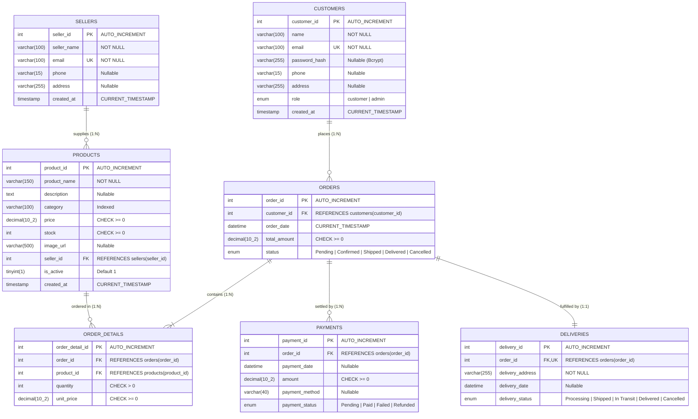

# Fashionista — Database Design & Relational Schema Specification

## 1. Project Overview & Team Details
- **Project Name:** Fashionista – E-Commerce Management Database System
- **Academic Context:** DBMS Capstone Project (5 Evaluation Phases, 20 Marks Each)
- **Team Members:**
  - **Nikhil Kumar Singh** — Roll No: 2501010151
  - **Jitesh Kumar** — Roll No: 2501010180
- **RDBMS Engine:** MySQL 8.0+ (InnoDB Storage Engine)
- **Database Name:** `ecommerce_management_db`

---

## 2. Entity-Relationship (ER) Model

### Core Entities & Descriptions
1. **Customers:** Represents registered buyers and system administrators with secured authentication credentials and personal contact profiles.
2. **Sellers:** Independent merchants and brands supplying fashion inventory to the platform.
3. **Products:** Merchandised clothing, footwear, and accessory items with real-time stock levels, categorization, and pricing.
4. **Orders:** Commercial transactions placed by authenticated customers detailing timestamps, statuses, and authoritative totals.
5. **Order_Details:** Line-item junction records detailing exact products, quantities, and historical purchase prices per order.
6. **Payments:** Financial settlement records for orders, capturing payment dates, methods (UPI Demo, Card Demo, COD), and transaction states.
7. **Deliveries:** Fulfillment and logistics records managing shipment tracking, courier delivery addresses, and dispatch milestones.

### ER Diagram (Mermaid Representation)

---

## 3. Relational Schema & Cardinality Details

| Source Entity | Target Entity | Relationship Type | Cardinality | Enforcing Key / Constraint |
| :--- | :--- | :--- | :--- | :--- |
| `Customers` | `Orders` | One-to-Many (1:N) | One customer can place 0 or many orders; each order belongs to exactly 1 customer. | `orders.customer_id` → `customers.customer_id` (`fk_orders_customer`) |
| `Sellers` | `Products` | One-to-Many (1:N) | One seller offers multiple products; each product is supplied by 1 seller. | `products.seller_id` → `sellers.seller_id` (`fk_products_seller`) |
| `Orders` | `Order_Details`| One-to-Many (1:N) | One order contains 1 or more line items; each line item belongs to 1 order. | `order_details.order_id` → `orders.order_id` (`fk_details_order`) |
| `Products` | `Order_Details`| One-to-Many (1:N) | A product may be referenced in multiple order details across orders. | `order_details.product_id` → `products.product_id` (`fk_details_product`) |
| `Orders` | `Payments` | One-to-Many (1:N) | An order can have multiple payment attempts/records (e.g., initial failed attempt followed by successful retry or split payment). | `payments.order_id` → `orders.order_id` (`fk_payments_order`) |
| `Orders` | `Deliveries` | One-to-One (1:1) | Each placed order has exactly one delivery fulfillment tracking record in the schema. | `deliveries.order_id` has `UNIQUE KEY (order_id)` & `fk_deliveries_order` |

---

## 4. Normalization Analysis (Up to 3NF & BCNF)

### First Normal Form (1NF)
- **Criteria:** All column values must be atomic (no arrays or comma-delimited strings), and each table must possess a primary key with unique row identification.
- **Verification:**
  - Attributes such as `phone`, `address`, and `payment_method` contain single, atomic data.
  - Multi-valued product purchases are separated into the `order_details` junction table rather than stored as serialized strings in `orders`.
  - Every table has a well-defined integer surrogate primary key (`customer_id`, `product_id`, etc.).

### Second Normal Form (2NF)
- **Criteria:** The relation must be in 1NF, and all non-key attributes must be fully functionally dependent on the primary key (no partial dependencies on a composite key).
- **Verification:**
  - Tables utilize single-column surrogate primary keys (`AUTO_INCREMENT`), inherently avoiding partial functional dependencies.
  - In `order_details`, although `(order_id, product_id)` is a natural candidate key (`uq_order_product`), non-key attributes `quantity` and `unit_price` depend on the specific line item as a whole, not partially on either `order_id` or `product_id`.

### Third Normal Form (3NF)
- **Criteria:** The relation must be in 2NF, and no non-key attribute is transitively dependent on the primary key ($X \to Y$ and $Y \to Z$ where $Z$ is not a superkey).
- **Verification:**
  - In `products`, seller information (seller name, seller email) is segregated into `sellers` rather than stored in `products`. Hence, $product\_id \to seller\_id \to seller\_name$ transitive dependencies are eliminated.
  - In `orders`, customer address and customer phone are referenced via `customer_id`, not duplicated inside `orders`.
  - In `order_details`, the product name and current catalogue price are referenced via `product_id`. `unit_price` in `order_details` stores the historical purchase-time price, which is an independent business attribute of that transaction, not a transitive dependency on the current catalogue price.

### Boyce-Codd Normal Form (BCNF)
- Every determinant in every functional dependency is a superkey. For example, in `customers`, $email \to (customer\_id, name, ...)$ holds, and `email` is designated as a candidate key via `UNIQUE KEY`.

---

## 5. Justification for Derived / Stored Field: `orders.total_amount`

In strict relational theory, an order's aggregate total $\sum (quantity \times unit\_price)$ can be recomputed dynamically. However, storing `Orders.total_amount` is a deliberate, standard commercial database pattern justified by:
1. **Audit & Legal Immutability:** Once an invoice/order is placed, its payable total is finalized. Dynamic re-aggregation can be susceptible to subsequent changes, discounts, or manual corrections unless frozen.
2. **High-Performance Querying:** Eliminates mandatory table joins and aggregate functions on `order_details` when querying customer order history, generating admin lists, or calculating seller sales reports.
3. **Integrity Enforcement:** Managed authoritatively during checkout inside database transactions and validated via database procedures (`sp_recalculate_order_total`).

---

## 6. Table Schemas, Constraints & Data Types

Refer to `server/sql/schema.sql` for the complete DDL implementation.
Key constraints:
- `products.price >= 0` (`products_chk_1`)
- `products.stock >= 0` (`products_chk_2`)
- `orders.total_amount >= 0` (`orders_chk_1`)
- `order_details.quantity > 0` (`order_details_chk_1`)
- `order_details.unit_price >= 0` (`order_details_chk_2`)
- `payments.amount >= 0` (`payments_chk_1`)
- `uq_order_product UNIQUE(order_id, product_id)`
- Foreign keys with referential integrity across all related tables.
